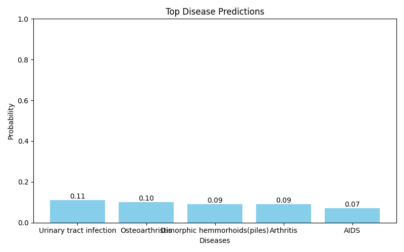

# Smart Health Advisor

An educational Flask app that turns a list of symptoms into model scores, visualizes the five highest-scoring disease labels and looks up associated specialists in local CSV files.



## Follow one prediction

1. The [Flask route](app.py) normalizes comma-separated symptom names.
2. The [inference function](ml_model.py) encodes the names with `mlb.pkl`, loads `model.pkl` and plots the five highest class scores.
3. The result page shows the highest-scoring label and specialist matches from the local dataset. A separate search lets users browse doctors by specialty.

## Local setup

From the repository root, set `base_path` in `app.py` to the local `data` directory. Then run:

```sh
python -m pip install flask pandas matplotlib seaborn scikit-learn joblib numpy
python app.py
```

Open the address printed by Flask. Run from the repository root so the encoder, model and static assets resolve correctly. This project demonstrates a classification workflow for educational use. The displayed scores have no established clinical interpretation.
