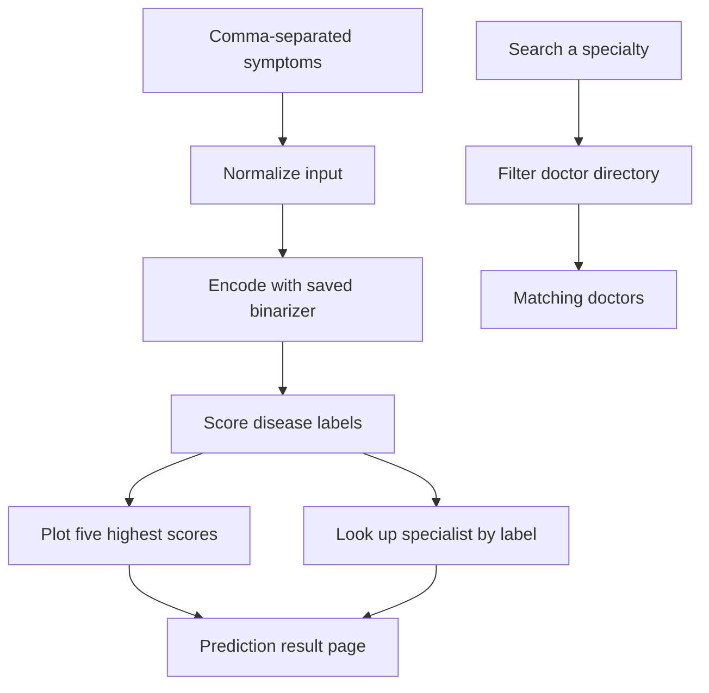

# Smart Health Advisor

An educational Flask app that turns a list of symptoms into model scores, visualizes the five highest-scoring disease labels and looks up associated specialists in local CSV files.

## Local preview


The Flask home page loaded locally after pointing the data directory at the checked-out CSV files. The chart below the preview is a repository example.


## Problem and goal

A single predicted label hides the other classes a model considered. This educational project lets a learner trace symptom input through feature encoding, inspect the distribution of model scores and see how a separate CSV lookup maps a label to a specialist.

## Workflow



## Languages, tools and interfaces

| Component | Role |
| --- | --- |
| Python, Flask, Jinja, HTML, CSS and JavaScript | Serve the interface, receive form data and issue browser requests |
| pandas, NumPy, scikit-learn and joblib | Load CSVs, encode symptoms, rank scores and load model artifacts |
| Matplotlib and seaborn | Generate prediction, symptom-weight and specialist-count charts |
| `POST /predict` | Reads the `symptoms` form field and renders the prediction |
| `GET /search_doctor` and `POST /search_doctor` | Display the form and search specialties in the local directory |
| `GET /get_doctors/<speciality>` | Returns matching names as a JSON `doctors` list |
| `POST /chatbot` | Accepts a JSON `message` and returns a predefined keyword-based `reply` |
| `GET /visualize_symptoms` | Generates the symptom-weight chart from a CSV |

The hospital button opens a Google Maps search in the browser. The model and directory lookup run locally.

## Follow one prediction

1. The [Flask route](app.py) normalizes comma-separated symptom names.
2. The [inference function](ml_model.py) encodes the names with `mlb.pkl`, loads `model.pkl` and plots the five highest class scores.
3. The result page shows the highest-scoring label and specialist matches from the local dataset. A separate search lets users browse doctors by specialty.

## Run on Windows with PowerShell

```powershell
git clone https://github.com/Ashishkumar401/smart_health_advisor.git
Set-Location .\smart_health_advisor
py -3 -m venv .venv
.\.venv\Scripts\python.exe -m pip install flask pandas matplotlib seaborn scikit-learn joblib numpy
notepad .\app.py
```

In the local copy of `app.py`, change the existing machine-specific `base_path` assignment to the line below. Save the file before starting Flask.

```python
base_path = os.path.join(os.path.dirname(os.path.abspath(__file__)), "data")
```

```powershell
.\.venv\Scripts\python.exe -m flask --app app run --host 127.0.0.1 --port 5000
```

Open the address printed by Flask. Run from the repository root so the encoder, model and static assets resolve correctly. This project demonstrates a classification workflow for educational use. The displayed scores have no established clinical interpretation.

## Deployment status

The repository has no public homepage URL or GitHub deployment record. The screenshot above was captured on localhost. A separate hosted instance could not be verified.
